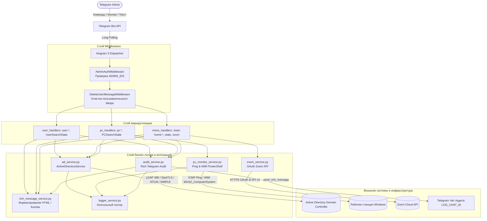
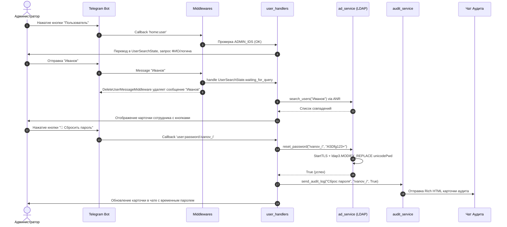

# 01. Архитектура системы Kolins

| Параметр | Значение |
|---|---|
| Проект | Kolins · AD Control |
| Версия документа | 1.0 |
| Дата | 2026-11-09 |
| Статус | Утверждён |
| Автор | AI Documentation Agent |

## Содержание
1. [Общая архитектурная схема](#1-общая-архитектурная-схема)
2. [Компоненты системы](#2-компоненты-системы)
3. [Потоки данных и обработка запросов](#3-потоки-данных-и-обработка-запросов)
4. [Механизм аутентификации в Active Directory](#4-механизм-аутентификации-в-active-directory)
5. [История изменений документа](#5-история-изменений-документа)

---

## 1. Общая архитектурная схема

## 2. Компоненты системы

| Модуль / Слой | Назначение | Ключевые файлы |
|---|---|---|
| **Точка входа** | Инициализация бота, регистрация миддлварей и роутеров, запуск `start_polling` | [main.py](file:///c:/Users/kbeletskiy/Documents/Kolins/main.py#L1-L50) |
| **Конфигурация** | Чтение `.env`, парсинг списков ID, настройка базового DN | [config.py](file:///c:/Users/kbeletskiy/Documents/Kolins/config.py#L1-L14) |
| **Middlewares** | Фильтрация неавторизованных пользователей и очистка входящих сообщений | [middlewares/auth_middleware.py](file:///c:/Users/kbeletskiy/Documents/Kolins/middlewares/auth_middleware.py#L1-L28) [middlewares/delete_message_middleware.py](file:///c:/Users/kbeletskiy/Documents/Kolins/middlewares/delete_message_middleware.py#L1-L26) |
| **Обработчики (Handlers)** | Обработка текстовых команд, callback-кнопок, управление состояниями FSM | [handlers/menu_handlers.py](file:///c:/Users/kbeletskiy/Documents/Kolins/handlers/menu_handlers.py#L1-L148) [handlers/user_handlers.py](file:///c:/Users/kbeletskiy/Documents/Kolins/handlers/user_handlers.py#L1-L198) [handlers/pc_handlers.py](file:///c:/Users/kbeletskiy/Documents/Kolins/handlers/pc_handlers.py#L1-L166) [handlers/states.py](file:///c:/Users/kbeletskiy/Documents/Kolins/handlers/states.py#L1-L9) |
| **Active Directory Сервис** | Работа с каталогом LDAP (поиск, смена пароля, перемещение, статус) | [services/ad_service.py](file:///c:/Users/kbeletskiy/Documents/Kolins/services/ad_service.py#L1-L439) |
| **PC Мониторинг** | Асинхронный запуск системных утилит (Ping, WMI PowerShell) | [services/pc_monitor_service.py](file:///c:/Users/kbeletskiy/Documents/Kolins/services/pc_monitor_service.py#L1-L70) |
| **Zoom Сервис** | Взаимодействие с Zoom REST API по протоколу Server-to-Server OAuth | [services/zoom_service.py](file:///c:/Users/kbeletskiy/Documents/Kolins/services/zoom_service.py#L1-L72) |
| **Сервис аудита** | Отправка форматированных отчетов об административных действиях | [services/audit_service.py](file:///c:/Users/kbeletskiy/Documents/Kolins/services/audit_service.py#L1-L34) |
| **Rich Message Сервис** | Формирование Telegram Rich HTML (кнопки, таблицы, спойлеры) | [services/rich_message_service.py](file:///c:/Users/kbeletskiy/Documents/Kolins/services/rich_message_service.py#L1-L85) |

## 3. Потоки данных и обработка запросов

### 3.1. Сценарий: Поиск сотрудника и сброс пароля

## 4. Механизм аутентификации в Active Directory
В связи с тем, что в современных версиях Python (3.12+ и особенно 3.14) алгоритм хеширования MD4 объявлен устаревшим и может отсутствовать в OpenSSL, в [services/ad_service.py](file:///c:/Users/kbeletskiy/Documents/Kolins/services/ad_service.py#L9-L86) встроена чистая реализация `PureMD4`, патчащая `hashlib.new("md4")`.

Схема подключения к контроллеру домена реализует 2-ступенчатый отказоустойчивый алгоритм:
1. **Первичная попытка:** подключение через `ldap3.NTLM` на порт 389.
2. **Вторичная попытка (Fallback):** если NTLM не проходит, устанавливается соединение `ldap3.SIMPLE` в связке с принудительным `start_tls()`.
3. **Keep-Alive & Reconnect:** перед каждым поиском и модификацией вызывается `_safe_search` и `ensure_connection`, повторно поднимающие сокет при разрыве сетевой сессии.

## 5. История изменений документа

| Версия | Дата | Автор | Описание изменений |
|---|---|---|---|
| 1.0 | 2026-11-09 | AI Documentation Agent | Создание архитектурного описания, диаграмм и потоков данных. |
