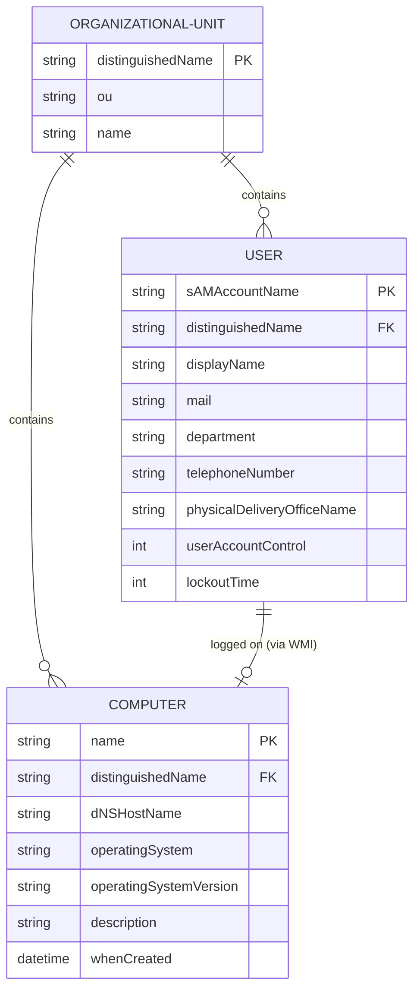

# 04. Модель Данных и Состояния

| Параметр | Значение |
|---|---|
| Проект | Kolins · AD Control |
| Версия документа | 1.0 |
| Дата | 2026-11-09 |
| Статус | Утверждён |
| Автор | AI Documentation Agent |

## Содержание
1. [Объекты и структуры данных Active Directory](#1-объекты-и-структуры-данных-active-directory)
2. [ER-диаграмма сущностей каталога](#2-er-диаграмма-сущностей-каталога)
3. [Состояние FSM (Finite State Machine)](#3-состояние-fsm-finite-state-machine)
4. [Хранилище в оперативной памяти (In-Memory State)](#4-хранилище-в-оперативной-памяти-in-memory-state)
5. [Локальная БД (SQLite)](#5-локальная-бд-sqlite)
6. [История изменений документа](#6-история-изменений-документа)

---

## 1. Объекты и структуры данных Active Directory

Система не хранит данные пользователей и компьютеров локально, а выступает тонким клиентом над базой Active Directory (NTDS.dit).

### 1.1. Сущность: Пользователь (`objectClass=user`)

| Атрибут AD | Поле в коде | Тип | Описание |
|---|---|---|---|
| `sAMAccountName` | `username` | String | Уникальный логин пользователя в домене (pre-Windows 2000) |
| `displayName` | `display_name` | String | Отображаемое имя (ФИО) |
| `mail` | `mail` | String | Корпоративный адрес электронной почты |
| `department` | `department` | String | Наименование подразделения / отдела |
| `telephoneNumber` | `telephone_number` | String | Рабочий номер телефона |
| `physicalDeliveryOfficeName` | `physical_delivery_office_name` | String | Номер кабинета / локация |
| `distinguishedName` | `dn` | String | Полный LDAP-путь в дереве каталога |
| `userAccountControl` | `is_disabled` | Boolean | Битовая маска флагов (бит 2: `ACCOUNTDISABLE`) |
| `lockoutTime` | — | Integer | Временная метка блокировки (0 — не заблокирован) |
| `unicodePwd` | — | Bytes | Пароль пользователя в кодировке UTF-16LE в кавычках |

### 1.2. Сущность: Компьютер (`objectClass=computer`)

| Атрибут AD | Поле в коде | Тип | Описание |
|---|---|---|---|
| `name` | `name` | String | Сетевое имя рабочей станции (NetBIOS) |
| `dNSHostName` | `dns_name` | String | Полное FQDN-имя компьютера в сети |
| `operatingSystem` | `os` | String | Наименование установленной ОС Windows |
| `operatingSystemVersion`| `os_version` | String | Номер сборки и версии ОС |
| `description` | `description` | String | Описание учетной записи ПК |
| `whenCreated` | `created` | String | Дата создания объекта в AD |
| `distinguishedName` | `dn` | String | Полный LDAP-путь объекта ПК |

---

## 2. ER-диаграмма сущностей каталога



---

## 3. Состояние FSM (Finite State Machine)

Для обеспечения бесконфликтного пошагового ввода данных бот использует `MemoryStorage` фреймворка aiogram:

| Класс состояния | Состояние | Назначение | Сохраняемые данные (`state.data`) |
|---|---|---|---|
| `UserSearchState` | `waiting_for_query` | Ожидание ввода ФИО/логина | `rich_chat_id`, `rich_message_id` |
| `PCSearchState` | `waiting_for_query` | Ожидание имени или описания ПК | `rich_chat_id`, `rich_message_id` |
| `ZoomState` | `waiting_for_topic` | Ожидание темы видеоконференции | `rich_chat_id`, `rich_message_id` |

---

## 4. Хранилище в оперативной памяти (In-Memory State)
В модуле `handlers/user_handlers.py` объявлена глобальная переменная:
```python
USER_ORIGINAL_OU = {}  # { "username": "OU=Original,DC=kdb,DC=kz" }
```
- Служит для временного запоминания исходного OU сотрудника перед его перемещением в `OU=notebooklenovo`.
- > [!WARNING]
  > При перезапуске процесса бота содержимое `USER_ORIGINAL_OU` сбрасывается. Если сотрудник был перемещён и бот перезапустился, кнопка возврата не сможет автоматически определить исходный OU.

---

## 5. Локальная БД (SQLite)
В файле `services/db_service.py` объявлено подключение к `database.db`. В текущей версии бота таблицы не создаются и операции с БД не производятся.

## 6. История изменений документа

| Версия | Дата | Автор | Описание изменений |
|---|---|---|---|
| 1.0 | 2026-11-09 | AI Documentation Agent | Формирование описания атрибутов AD, ER-диаграммы, FSM-состояний. |
